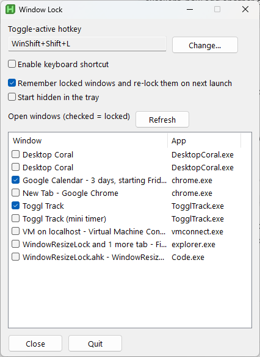

# Window Resize Lock

Stops selected windows from being resized. Edge-dragging and the maximize button no longer change the size. The border usually stays.

Requires [AutoHotkey v2](https://www.autohotkey.com/). Run `WindowResizeLock.ahk`.

## What you can do

- **Lock or unlock windows.** Check a window in the list, or press the shortcut (Win+Shift+L by default) to toggle the active window. A check applies to that window’s program and title, so other windows from the same program stay as they are.
- **Change the shortcut.** Click **Change…** and press the keys you want.
- **Turn the shortcut off.** Uncheck **Enable keyboard shortcut**. The chosen shortcut is kept for when you turn it back on.
- **Remember locks.** Check **Remember locked windows** and the same windows are locked again the next time they are open.
- **Start in the tray.** Check **Start hidden in the tray** to skip the window on launch. Click the tray icon to open it.
- **Quit.** **Quit** (or Exit on the tray menu) restores every window this script locked. **Close** only hides the window.

Settings are saved next to the script in `WindowResizeLock.ini`.

## Limits

The script removes the sizing border (`WS_THICKFRAME`) and the maximize box (`WS_MAXIMIZEBOX`), then puts them back if the app resets them. Some apps draw their own frame and ignore this, including many Electron, game, and WinUI windows.

Two windows that share both the same program and the exact same title are treated as one.
